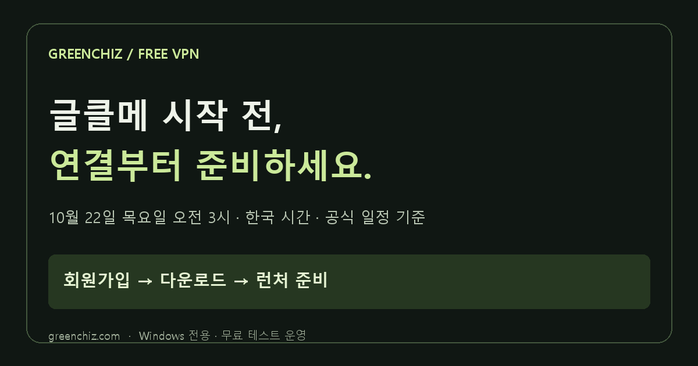

# 그린치즈 VPN · GREENCHIZ VPN

**글클메 시작 전, 연결부터 준비하세요.**

글로벌 메이플스토리 클래식 월드 출시를 준비하는 한국 Windows 이용자를 위한 무료 VPN 테스트 서비스입니다. 서비스 운영자가 제공하는 공개 안내입니다.

[출시 준비 가이드](https://greenchiz.com/maplestory-classic?utm_source=github&utm_medium=readme&utm_campaign=classic_launch_20261022) · [무료 회원가입](https://greenchiz.com/member/signup) · [Windows 다운로드](https://greenchiz.com/download) · [고객지원](https://greenchiz.com/bugs)

## 출시 시간

넥슨 공식 FAQ의 정식 오픈 시각은 **2026년 10월 21일 11:00 AM PDT**, 한국 시간으로 **10월 22일 목요일 오전 3시(KST)**입니다. 실제 오픈과 변경 여부는 [넥슨 공식 FAQ](https://www.nexon.com/maplestory/news/general/45385)를 확인하세요. 2026-10-20 확인.

## 시작 순서

1. [사이트 회원가입](https://greenchiz.com/member/signup)에서 이메일 인증과 비밀번호 설정을 마치세요.
2. [현재 배포 버전](https://greenchiz.com/download)을 설치하세요.
3. 넥슨 런처를 설치하고 한 번 실행한 뒤 완전히 종료하세요.
4. 그린치즈 앱에 사이트와 같은 그린치즈 계정으로 로그인하고 연결 안내를 따르세요.

넥슨 게임 계정과 그린치즈 계정은 별도입니다. 넥슨 비밀번호를 그린치즈에 입력하지 마세요.

## 지원 범위

| 항목 | 현재 상태 |
| --- | --- |
| 이용 요금 | 무료 테스트 운영 |
| 운영체제 | Windows |
| 현재 다운로드 | 0.1.38 · 글클메 한국 → 미국 연결 |
| 게임·브라우저·런처 선택 | GREENCHIZ NEXT 별도 개발판 |

환경에 따라 연결 품질과 호환성이 다를 수 있으며 게임 접속, 지연 시간 감소 또는 제재 면제를 보장하지 않습니다. 그린치즈는 넥슨과 제휴하지 않은 독립 서비스입니다.

## 도움이 되는 안내

- [회원가입부터 연결까지](https://greenchiz.com/guides/greenchiz-start)
- [넥슨 런처를 설치했는데 연결이 안 될 때](https://greenchiz.com/guides/nexon-launcher)
- [실제 개발판 앱 화면](https://greenchiz.com/#app-preview)
- [공유 이미지와 소개 문구](https://greenchiz.com/press)
- [안내 RSS](https://greenchiz.com/feed.xml)

## 공유 자료

`images/`의 자체 제작 브랜드 이미지와 `copy/`의 소개 문구는 서비스 소개 목적으로 무료 공유할 수 있습니다. 홍보가 허용된 공간에서 운영자 제공 자료임을 밝혀 주세요. 넥슨 공식 홍보나 이용 후기처럼 표현하지 마세요. 게임 로고·게임 이미지는 포함하지 않습니다.

## English summary

Greenchiz is a Korean Windows VPN service in free testing. The current 0.1.38 download supports its MapleStory Classic Korea-to-US route. Selected-app routing for other games, browsers and launchers is a separate NEXT development application. This repository contains public guides and original promotional assets. It does not contain the private client/server source or operational credentials. No game access, latency or sanction-exemption guarantees are made. Independent from Nexon.
