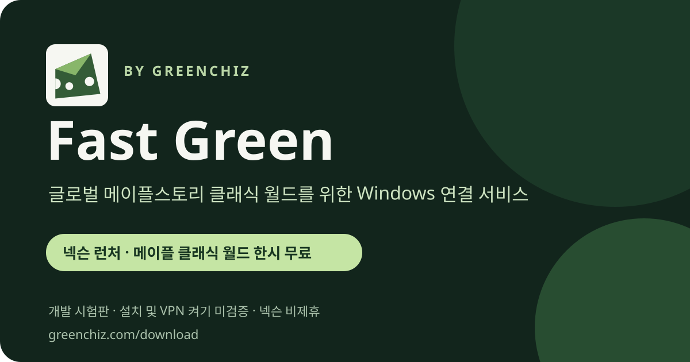

# Fast Green

**글로벌 메이플스토리 클래식 월드를 위한 Windows 연결 서비스**

Fast Green은 그린치즈가 제공하는 Windows 연결 서비스입니다. 현재 넥슨 런처와 메이플스토리 클래식 월드는 한시적으로 무료로 이용할 수 있습니다. 다른 지원 앱은 이용권이 필요하며 결제는 준비 중입니다. 현재 제공하는 연결 지역은 미국 한 곳입니다.

[홈페이지 다운로드](https://greenchiz.com/download) · [F7 시험판 설치파일](https://github.com/tkddlr0716-collab/greenchiz-vpn/releases/download/fastgreen-0.2.0-dev-f7/Fastgreen-0.2.0-dev-F7-Setup-x64.exe) · [고객지원](https://greenchiz.com/bugs)

## F7 개발 시험판

F7은 기존 그린치즈 로고와 아이콘, Fast Green 표시 이름을 적용한 Windows x64 설치 시험판입니다. F6에서 반영된 연결 준비 과정의 일부 권한 오류 수정을 포함합니다.

**F7은 실제 설치와 VPN 켜기까지 검증되지 않았습니다.** PC 환경에 따라 설치나 연결이 실패할 수 있습니다. 시험 중 문제가 생기면 고객지원에 알려 주세요.

- [F7 릴리스 안내](https://github.com/tkddlr0716-collab/greenchiz-vpn/releases/tag/fastgreen-0.2.0-dev-f7)
- 설치파일 크기: 304,411,648 bytes
- 설치파일 SHA-256: `13f6cfc2e215610303d570896e739c95290425881f5e59d4b92b6ef1c42bf683`

연결 품질과 호환성은 환경에 따라 다릅니다. 게임 접속, 지연 시간 개선 또는 모든 PC에서의 동작을 보장하지 않습니다. Fast Green은 넥슨과 제휴하지 않은 독립 서비스입니다.

## 공유 자료

이 저장소의 `copy/` 소개 문구와 `images/fast-green-share.svg`는 서비스 소개에 사용할 수 있습니다. 운영자 제공 자료임을 밝히고, 공식 제휴나 이용 후기처럼 표현하지 말아 주세요.
